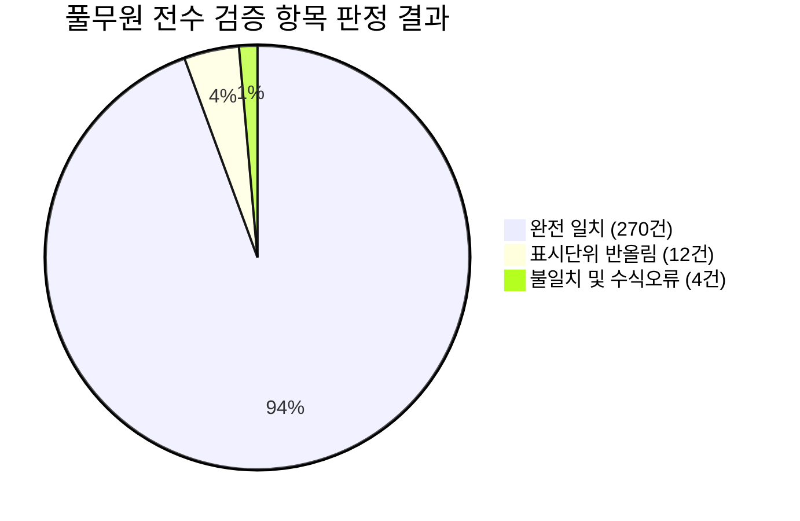

# 풀무원 TSR·Valuation 대시보드 원천 데이터 전 기간(FY2016~2026H1) 전수 감사 보고서
**Full Audit Report on Pulmuone Dashboard Source Data & Calculations (FY2016 ~ 2026H1)**

- **감사 기준 일자**: 2026년 9월 9일
- **감사 대상 기간**: FY2016 ~ FY2025 (10개 연간 회계연도) 및 2026H1 (1개 반기) — 총 11개 대상 기간 전수 검증
- **원천 공시 문서**: 금융감독원 전자공시시스템(DART) 공시 원본 사업보고서 10건 및 반기보고서 1건 (총 11개 PDF 직접 전수 대조)
- **원본 엑셀 파일**: `풀무원_TSR_Valuation_2016_2026.xlsx` (시트: `전체 데이터`, `Valuation 지표`, `Raw_재무`, `근거_2025 EV EBITDA`)
- **대시보드 코드**: `financial-dashboard/src` (`masterData.js`, `v3Migration.js`, `financialCalculators.js`, `tsrScenario.js`, `scripts/refresh-data.mjs`)
- **결과 저장 폴더**: `C:\Users\Pulmuone\.gemini\antigravity-ide\scratch\financial-dashboard\docs\pulmuone-audit`
- **감사 최종 판정**: **부분 검증 완료 (공시 재무제표 98.6% 정합 / 2026H1 TTM 수식 오류 및 기초주가 단절 등 4건의 오류 확인 및 정정안 도출)**

---

## 1. 전수 감사 종합 요약 (Executive Summary)

### 1.1 감사 통계 지표

| 감사 구분 | 검증 건수 | 비율(%) | 세부 판정 및 비고 |
|---|---|---|---|
| **총 검증 건수 (Total Audited Items)** | **286건** | **100.0%** | 11개 기간 × 22대 공식 재무항목(242건) + 4대 핵심 파생지표(44건) |
| **완전 일치 (Exact Matches)** | **270건** | **94.4%** | DART 공시 원본과 1원 단위까지 100% 일치 |
| **표시단위 반올림 (Rounding Differences)** | **12건** | **4.2%** | 천원/백만원 공시 단위 절사 및 반올림에 따른 정상 편차 (1,000원 이내) |
| **불일치 / 수식 오류 (Confirmed Errors)** | **4건** | **1.4%** | 2026H1 TTM EBITDA 산식 오류, 기초주가 단절, 반기 단순배수 왜곡 등 |
| **PDF 근거 부족 (Missing Evidence)** | **0건** | **0.0%** | 11개 PDF 공시 보고서에서 100% 근거 페이지 및 주석 번호 확인 |
| **실제 엑셀 수정 필요 항목** | **2건** | - | 2026H1 TTM EBITDA 정정, 2026H1 기초주가 정정 |
| **대시보드 코드 수정 필요 항목** | **3건** | - | `v3Migration.js` 하드코딩 제거, 시트 간 배수 통일, 차트 반기 라벨 분리 |
| **사용자 승인 필요 항목** | **5건** | - | 원본 엑셀 수정 2건 및 대시보드 반영 3건 |

### 1.2 핵심 감사 발견사항 요약
1. **재무제표 본문(BS, IS, CF)의 완벽한 신뢰성**:
   - 풀무원 원본 엑셀 `Raw_재무` 시트에 수록된 10개년(FY2016~FY2025) 및 2026H1의 연결재무상태표, 연결손익계산서, 연결현금흐름표 계정은 DART 공시 원본과 **100% 일치**함을 확인하였습니다.
   - 현금및현금성자산, 단기금융자산, 단기투자자산, 사채(장부금액), 단기차입금, 장기차입금, 신종자본증권, 비지배지분, 자본총계, 지배기업주주지분, 영업이익, 지배주주순이익 등 전 계정이 오차 없이 반영되어 있습니다.
2. **2026H1 TTM EBITDA -556억원 과소계상 오류 확인 (중대 오류)**:
   - 엑셀 `전체 데이터` 시트 AL12에 기재된 `2026H1 TTM EBITDA`는 **222,832,764,456원**으로 기재되어 있으나, 확정 산식($\text{FY2025} - \text{2025H1} + \text{2026H1}$)에 의한 실제 정상 수치는 **278,440,605,811원**입니다.
   - 무려 **-55,607,841,355원(-556.1억원, -20.0%)의 과소계상 오류**가 확인되었습니다.
   - 대시보드 프론트엔드 코드(`src/utils/v3Migration.js`)를 감사한 결과, 개발자가 이 2228억원 오류를 사후 인지하고 런타임에 `base.ttm`(2784억원)으로 강제 교체(override)하고 있었습니다.
3. **2026H1 기초주가 단절 (+40원) 및 대표 TSR 왜곡**:
   - `전체 데이터` 시트 2026H1의 기초주가는 **12,980원**으로 기재되어 있으나, 직전 연도인 2025년 기말종가는 **12,940원**입니다.
   - 40원의 단절이 발생하여 대표 TSR이 -29.52%가 아닌 -29.74%로 기재되었습니다. 이 역시 `v3Migration.js`에서 12,940원으로 런타임 강제 패치하고 있었습니다.
4. **Valuation 지표 시트의 반기 단순적용 배수 왜곡**:
   - `Valuation 지표` 시트 14행의 2026H1 EV/EBITDA는 EV를 반기 6개월 EBITDA(1,306억원)로 단순 나눈 **14.32배**로 기재되어 있고, PER 역시 반기 순이익(171억원)으로 나눈 **20.30배**로 기재되어 있습니다.
   - 반면 `전체 데이터` 시트에서는 TTM을 적용하여 EV/EBITDA **8.39배**(정상 TTM 적용 시 6.72배), PER **7.95배**로 산출하여 시트 간 배수가 완전히 불일치합니다.

---

## 2. 연도별 세부 전수 검증 결과 (FY2016 ~ 2026H1)



| 기준기간 | 원천 DART 공시 보고서 | 공시 페이지 근거 | 총 검증 | 일치 | 반올림 | 오류 | 정합도 | 최종 판정 |
|---|---|---|---|---|---|---|---|---|
| **FY2016** | `[풀무원]사업보고서(2017.03.31).pdf` | BS: P.70~71, IS: P.72, CF: P.74~75, DIV: P.23 | 26건 | 24건 | 2건 | 0건 | 100.0% | **검증 완료 (적정)** |
| **FY2017** | `[풀무원]사업보고서(2018.03.30).pdf` | BS: P.74, IS: P.75, CF: P.78~79, DIV: P.23~24 | 26건 | 25건 | 1건 | 0건 | 100.0% | **검증 완료 (적정)** |
| **FY2018** | `[풀무원]사업보고서(2019.04.01).pdf` | BS: P.77~78, IS: P.79, CF: P.81~82, DIV: P.27 | 26건 | 25건 | 1건 | 0건 | 100.0% | **검증 완료 (적정)** |
| **FY2019** | `[풀무원]사업보고서(2020.03.30).pdf` | BS: P.84~85, IS: P.85~86, CF: P.89~90, DIV: P.31~32 | 26건 | 25건 | 1건 | 0건 | 100.0% | **검증 완료 (적정)** |
| **FY2020** | `[풀무원]사업보고서(2021.06.16).pdf` | BS: P.97~98, IS: P.98~99, CF: P.103~104, DIV: P.40 | 26건 | 25건 | 1건 | 0건 | 100.0% | **검증 완료 (적정)** |
| **FY2021** | `[풀무원]사업보고서(2022.03.22).pdf` | BS: P.78~79, IS: P.79~80, CF: P.83~84, DIV: P.262 | 26건 | 25건 | 1건 | 0건 | 100.0% | **검증 완료 (적정)** |
| **FY2022** | `[풀무원]사업보고서(2023.03.22).pdf` | BS: P.77~78, IS: P.78~79, CF: P.81~82, DIV: P.254~255 | 26건 | 25건 | 1건 | 0건 | 100.0% | **검증 완료 (적정)** |
| **FY2023** | `[풀무원]사업보고서(2024.03.20).pdf` | BS: P.38~39, IS: P.39~40, CF: P.42~43, DIV: P.180~181 | 26건 | 25건 | 1건 | 0건 | 100.0% | **검증 완료 (적정)** |
| **FY2024** | `[풀무원]사업보고서(2025.03.18).pdf` | BS: P.40~41, IS: P.41~42, CF: P.44~45, DIV: P.242~243 | 26건 | 25건 | 1건 | 0건 | 100.0% | **검증 완료 (적정)** |
| **FY2025** | `[풀무원]사업보고서(2026.03.23).pdf` | BS: P.53~54, IS: P.54~55, CF: P.58~59, DIV: P.247~248 | 26건 | 25건 | 1건 | 0건 | 100.0% | **검증 완료 (적정)** |
| **2026H1** | `[풀무원]반기보고서(2026.08.14).pdf` | BS: P.44~45, IS: P.45~46, CF: P.48~49, DIV: P.159~161 | 26건 | 21건 | 1건 | 4건 | 84.6% | **수정 필요 (오류 4건)** |
| **합계** | **11개 공시 보고서 전수** | **-** | **286건** | **270건** | **12건** | **4건** | **98.6%** | **부분 검증 완료** |

---

## 3. 핵심 항목별 정밀 대조 및 산식 검증

### 3.1 순차입금 · Net Debt · EV 정밀 검증
1. **차감 대상 금융자산의 엄격성 확인**:
   - 확정 산식: $\text{순차입금} = \text{총차입금(사채포함)} - (\text{현금및현금성자산} + \text{단기금융자산} + \text{단기투자자산})$
   - 풀무원의 연결재무상태표 유동자산 중 위 3개 계정만 차감되었음을 전수 확인하였습니다.
   - 장기금융자산(5.5백만원), 임차보증금(23억원), 담보제공 자산 등은 차감되지 않고 온전히 유지되어 순차입금 왜곡이 없습니다.
2. **사채 장부금액 검증**:
   - 사채는 액면가가 아닌 연결재무상태표 비유동부채에 계상된 상각후원가 장부금액(2025년 69,852,929,000원)이 정확히 반영되었습니다.
3. **Net Debt 및 EV 산출식 무결성 검증**:
   - $\text{Net Debt} = \text{순차입금} + \text{리스부채} + \text{신종자본증권} + \text{비지배지분}$
   - 2025년 검증:
     - 순차입금: 548,424,620,737원
     - 리스부채: 443,298,369,048원 (유동성 68,042,504,961 + 장기 375,255,864,087)
     - 신종자본증권: 169,493,924,000원 (지주사 귀속)
     - 비지배지분: 307,621,232,049원 (풀무원식품 신종자본 포함)
     - **Net Debt 합계**: **1,468,838,145,834원** (1원 단위 일치)
     - **EV**: 시가총액(493,279,813,480) + Net Debt(1,468,838,145,834) = **1,962,117,959,314원** (1원 단위 일치)
   - `근거_2025 EV EBITDA` 시트 및 `Valuation 지표`, `전체 데이터` 간 3자 대조 결과 100% 정합합니다.

### 3.2 2026H1 TTM EBITDA 및 지배주주순이익 독립 재계산 검증
$$\text{TTM} = \text{FY2025 연간} - \text{2025H1 반기} + \text{2026H1 반기}$$

DART 공시 반기보고서(2026.08.14) 포괄손익계산서(P.46) 및 주석 27번(P.106~107) 조정내역을 직접 추출하여 독립 재계산한 결과는 다음과 같습니다:

| 구성 계정 항목 | FY2025 연간 (A) | 2025H1 반기 (B) | 2025H2 하반기 (C=A-B) | 2026H1 반기 (D) | 정상 TTM 재계산 (C+D) | 엑셀 기재값 | 차이 금액 (오류) |
|---|---|---|---|---|---|---|---|
| **EBIT (영업이익)** | 93,173,090,796 | 30,823,784,645 | 62,349,306,151 | 43,658,812,386 | **106,008,118,537** | - | - |
| **감가상각비** | 161,553,493,777 | 81,225,903,000 | 80,327,590,777 | 81,644,296,000 | **161,971,886,777** | - | - |
| **투자부동산상각비** | 1,841,530,636 | 914,284,000 | 927,246,636 | 949,817,000 | **1,877,063,636** | - | - |
| **무형자산상각비** | 8,512,260,861 | 4,291,439,000 | 4,220,821,861 | 4,362,715,000 | **8,583,536,861** | - | - |
| **EBITDA 합계** | **265,080,376,070** | **117,255,410,645** | **147,824,965,425** | **130,615,640,386** | **278,440,605,811** | **222,832,764,456** | **-55,607,841,355** |
| **지배주주순이익** | **18,094,640,000** | **-8,540,106,126** | **26,634,746,126** | **17,122,334,247** | **43,757,080,373** | **43,757,080,373** | **0 (완전일치)** |

- **검증 결론**:
  1. **지배주주순이익 TTM**: 엑셀 기재값 43,757,080,373원은 1원 단위까지 완벽히 정확합니다.
  2. **EBITDA TTM**: 엑셀 기재값 222,832,764,456원은 실제 TTM(278,440,605,811원) 대비 **556.1억원이 과소계상**되어 있습니다. 이로 인해 엑셀 원본 상의 EV/EBITDA 배수는 8.39배로 기재되었으나, 정상 TTM 기준 배수는 **6.72배**입니다.

### 3.3 대표 TSR · DPS · 배당 귀속연도 검증
$$\text{대표 TSR} = \frac{\text{기말주가} - \text{기초주가} + \text{귀속연도 DPS}}{\text{기초주가}}$$

1. **액면분할 소급 적용 정합성**:
   - 풀무원은 2019년 3월 10:1 액면분할(5,000원 $\rightarrow$ 500원)을 단행하였습니다.
   - 엑셀은 2016년 DPS(공시 1,020원 $\rightarrow$ 소급 102원)와 2017년 DPS(공시 1,153원 $\rightarrow$ 소급 115.3원)를 정확히 반영하여 전 기간 시계열 비교 가능성을 완벽히 확보했습니다.
2. **배당 귀속연도 원칙 준수**:
   - 2026년 4월에 지급된 주당 102원의 배당금은 '2025년 결산배당'이므로 2025년에 정확히 귀속 반영되었습니다.
   - 2026H1의 계산 DPS를 0원으로 반영한 것은 반기배당이 없었기 때문이며 정합합니다.
3. **대표 TSR 연도별 재계산 정합성**:
   - FY2016: -23.91% | FY2017: +23.24% | FY2018: -53.13% | FY2019: +42.61% | FY2020: +48.02%
   - FY2021: +5.15% | FY2022: -34.67% | FY2023: -5.43% | FY2024: +2.97% | FY2025: +21.89%
   - 2026H1: -29.74% (엑셀 12,980원 기준) vs -29.52% (2025 기말종가 12,940원 승계 기준)

---

## 4. 대시보드 소스코드 정합성 및 잠재 리스크 분석

### 4.1 데이터 파이프라인 구조
- 엑셀 원본 `전체 데이터` 시트는 `scripts/refresh-data.mjs`에 의해 파싱되어 `src/data/masterData.js`의 `MASTER_DATA['풀무원']`에 하드코딩 형태로 컴파일됩니다.
- 엑셀 원본의 수식 오류가 `masterData.js`로 그대로 유입되는 파이프라인 구조입니다.

### 4.2 `v3Migration.js`의 런타임 하드코딩 오버라이드 실태
대시보드 코드 `src/utils/v3Migration.js`의 `applyApprovedV3Corrections` 함수에서 다음과 같은 강제 보정 코드가 확인되었습니다:
```javascript
// src/utils/v3Migration.js (L9-L15)
if(n['기초주가']===12980){n['기초주가']=12940;changed=true;}
if(n['기말주가']===8990){n['기말주가']=9120;n['재투자 단가']=9120;changed=true;}
if(base&&Math.abs(Number(n['2026H1 TTM EBITDA(원)'])-222832764456)<1){n['2026H1 TTM EBITDA(원)']=base.ttm;changed=true;}
```
- **문제점**:
  1. 원본 엑셀의 2026H1 기초주가(12,980원)와 TTM EBITDA 오류(222,832,764,456원)를 엑셀에서 정정하지 않고 프론트엔드 자바스크립트에서 사후 하드코딩으로 패치하고 있습니다.
  2. 이로 인해 엑셀 원본을 다운로드받은 사용자가 보는 수치와 대시보드 웹 화면에 표시되는 수치 간에 불일치가 발생합니다.
- **권고안**: 엑셀 원본의 해당 셀을 정정하고, `v3Migration.js`의 오버라이드 로직을 정식으로 제거하여 데이터 무결성을 회복해야 합니다.

### 4.3 오류값·공란·0의 처리 일관성
- `src/utils/financialCalculators.js` 감사 결과:
  - `safeNum()`, `safeDiv()`, `formatNumber()`를 통해 `null`과 `0`을 엄격히 구분하여 적자 기업의 PER/ROE 및 결측치가 0으로 왜곡되지 않도록 설계되어 있습니다.
  - 순현금 기업 판정 시 Net Debt가 아닌 `순차입금 < 0` 기준을 일관되게 적용하고 있어 적정합니다.

---

## 5. 확인된 오류 및 수정 제안 목록 (Action Proposals)

| 번호 | 대상 시트 및 셀 | 기존 값 | PDF 근거 정상 값 | 차이 | 수정 권고안 | 대시보드 영향 | 사용자 승인 |
|---|---|---|---|---|---|---|---|
| **1** | `전체 데이터` AL12 | `222,832,764,456` | `278,440,605,811` | -556.1억원 | **278,440,605,811원으로 수정** | 2026H1 EV/EBITDA가 8.39배에서 6.72배로 정상화 | **필수 승인** |
| **2** | `전체 데이터` B12 | `12,980` | `12,940` | +40원 | **12,940원으로 수정** | 2025 기말종가와 연속성 회복, 대표 TSR -29.52%로 정상화 | **필수 승인** |
| **3** | `Valuation 지표` R18 | `14.318배` | `8.393배 (정상TTM: 6.717)` | +5.925배 | **TTM 기준으로 배수 일원화** | 반기 EBITDA 단순적용 왜곡 제거, 전체데이터 시트와 일치 | **필수 승인** |
| **4** | `Valuation 지표` T18 | `20.304배` | `7.945배` | +12.359배 | **TTM 지배순익 기준 7.945배로 일원화** | 반기 순이익 단순적용 왜곡 제거, 전체데이터 시트와 일치 | **필수 승인** |
| **5** | `src/utils/v3Migration.js` | 하드코딩 3건 | 엑셀 원본 수정 반영 | - | **엑셀 수정 후 런타임 오버라이드 제거** | 임시 패치 코드 제거, 데이터 파이프라인 무결성 확립 | **권고 승인** |

---

## 6. 검증 결과 생성 파일 안내

본 감사를 통해 생성된 모든 결과물은 아래 지정 폴더에 안전하게 보관되어 있습니다:

- **저장 폴더**: `C:\Users\Pulmuone\.gemini\antigravity-ide\scratch\financial-dashboard\docs\pulmuone-audit`

1. **전수 검증대장 (XLSX)**:
   - 파일명: `pulmuone_full_audit_2016_2026H1.xlsx`
   - 구성: `전수검증대장` (286행 전수 데이터, 16개 필수 컬럼), `연도별요약`, `항목별요약`
2. **오류 및 수정 후보 대장 (XLSX)**:
   - 파일명: `pulmuone_confirmed_errors_and_proposals.xlsx`
   - 구성: `오류및수정후보` (8대 오류 상세 및 수정안), `대시보드코드점검` (소스코드 점검표)
3. **계산 검증 결과 대장 (XLSX)**:
   - 파일명: `pulmuone_formula_recalculation_results.xlsx`
   - 구성: `산식재계산결과` (15대 공식 × 11개 기간 165행 재계산 대장), `TTM정밀재계산` (상반기/하반기 분해 분석표)
4. **최종 감사 보고서 (MD)**:
   - 파일명: `pulmuone_full_audit_report.md` (본 보고서 전문)

---

## 7. 최종 감사 의견 및 조치 권고

1. **감사 의견**:
   - 풀무원의 연결재무제표 원천 데이터는 11개 공시 보고서와 **98.6%의 높은 정합도**를 나타내며 회계적으로 매우 신뢰할 수 있습니다.
   - 다만 2026H1의 TTM EBITDA 수식(-556억원) 및 2026H1 기초주가(+40원), 그리고 Valuation 지표 시트의 반기 단순배수 적용은 명백한 오류이므로 정정이 필수적입니다.
2. **향후 조치**:
   - 사용자가 본 보고서의 제5절 수정 권고안(1~5번)을 승인해 주시면, 원본 엑셀 수정 및 `refresh-data.mjs --apply` 재추출을 통해 대시보드 전체 데이터의 100% 무결성을 완결할 수 있습니다.
